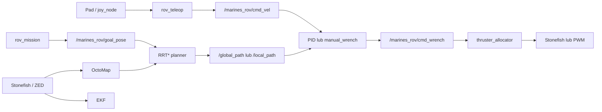

# Marines ROV

Workspace ROS 2 dla pojazdu podwodnego ROV. Projekt zawiera kompletny stos do:

- symulacji fizyki i sensorów w **Stonefish**,
- sterowania ROV-em padem,
- lokalizacji (EKF), tworzenia mapy 3D (OctoMap) i planowania trasy RRT*,
- realizacji misji autonomicznej,
- alokacji sił na 8 pędników,
- pracy z rzeczywistym ROV-em na NVIDIA Jetsonie i kamerą ZED 2i.

> Do sterowania prawdziwym pojazdem używaj najpierw bezpiecznego stanowiska testowego. Test pędników może uruchomić napędy.

## Architektura



## Wymagania

- Docker Engine wraz z Docker Compose v2;
- Linux z dostępem do X11 (`DISPLAY`) do wyświetlenia Stonefish/RViz;
- dla symulacji graficznej: sterownik NVIDIA i NVIDIA Container Toolkit;
- dla ROV-a: Jetson z JetPackiem, kamerą ZED 2i oraz dostępem do wymaganych urządzeń `/dev`.

Najprostsza i zalecana instalacja korzysta z obrazu Dockera. Zawiera ROS 2 Humble, Stonefish oraz zależności projektu.

## Pierwsze uruchomienie

Wykonaj na komputerze operatorskim, w katalogu repozytorium:

```bash
xhost +local:docker
docker compose up -d --build
docker compose exec rov-ros2-dev bash
```

W kontenerze zbuduj workspace i załaduj środowisko:

```bash
cd /home/dev/ros2_ws
rosdep install --from-paths src --ignore-src -r -y
colcon build --symlink-install
source install/setup.bash
```

Po zmianie plików źródłowych wystarczy ponownie wykonać dwie ostatnie komendy (`colcon build ...` i `source ...`). Kontener zatrzymasz poleceniem:

```bash
docker compose down
```

### Jetson

Na Jetsonie użyj osobnej definicji kontenera, która przekazuje CUDA, ZED i urządzenia USB do kontenera:

```bash
xhost +local:docker
docker compose -f docker-compose-jetson.yaml up -d --build
docker compose -f docker-compose-jetson.yaml exec rov-ros2-dev bash
cd /home/dev/ros2_ws
rosdep install --from-paths src --ignore-src -r -y
colcon build --symlink-install
source install/setup.bash
```

Jeśli GUI nie uruchamia się z kontenera, sprawdź na hoście `echo $DISPLAY` i uprawnienie X11 nadane przez `xhost`.

## Gotowe tryby pracy

Każde polecenie `ros2 launch` uruchamiaj po `source install/setup.bash`.

## Use cases

### UC-01 — Symulacja autonomiczna z omijaniem przeszkód

**Cel:** ROV ma samodzielnie popłynąć do celu, tworząc mapę przeszkód i omijając je po drodze.

**Warunki wstępne:** workspace jest zbudowany, środowisko ROS 2 jest załadowane, a kontener ma dostęp do wyświetlania X11. Use case działa całkowicie w symulacji — nie wymaga pada ani podłączonego ROV-a.

1. Wejdź do kontenera i załaduj workspace:

   ```bash
   cd /home/dev/ros2_ws
   source install/setup.bash
   ```

2. Uruchom autonomię z trybem `hybrid` oraz światem z przeszkodami:

   ```bash
   ros2 launch rov_bringup autonomy.launch.py \
     use_sim:=true nav_mode:=hybrid world:=labirynt
   ```

3. Obserwuj Stonefish i RViz. System kolejno: lokalizuje pojazd, buduje OctoMap z chmury punktów, publikuje cel misji, wyznacza trasę RRT* i koryguje ją lokalnie, gdy w pobliżu są zajęte komórki mapy.

4. W drugim terminalu kontenera sprawdź, czy pipeline działa:

   ```bash
   cd /home/dev/ros2_ws
   source install/setup.bash
   ros2 topic echo /marines_rov/global_path --once
   ros2 topic echo /marines_rov/local_path --once
   ros2 topic echo /marines_rov/path_complete
   ```

**Oczekiwany rezultat:** pojawia się `/marines_rov/global_path`, lokalny planer publikuje `/marines_rov/local_path`, a ROV dociera do celu określonego w `src/rov_mission/config/mission_params.yaml`. Przy osiągnięciu celu `/marines_rov/path_complete` przyjmuje wartość `true`.

**Dlaczego `hybrid`:** planner RRT* wyznacza globalną drogę wokół znanych przeszkód, natomiast `local_planner` analizuje `/occupied_cells_vis_array` i odsuwa lokalny punkt docelowy od przeszkód. To właśnie włącza reaktywne omijanie przeszkód. Nie używaj tu `nav_mode:=direct`, ponieważ omija on warstwę lokalnego planera.

**Zmiana celu:** przed uruchomieniem zmodyfikuj `goal.x`, `goal.y`, `goal.z` i opcjonalnie `goal.yaw` w [mission_params.yaml](src/rov_mission/config/mission_params.yaml), po czym wykonaj ponownie `colcon build --symlink-install` i `source install/setup.bash`.

**Zatrzymanie:** w terminalu z launch file naciśnij `Ctrl+C`, następnie — poza kontenerem — opcjonalnie zatrzymaj kontener przez `docker compose down`.

### 1. Pełna teleoperacja w symulacji

Uruchamia Stonefish, EKF, OctoMap, regulator PID, alokator pędników, obsługę pada i RViz:

```bash
ros2 launch rov_bringup teleop_joy.launch.py use_sim:=true enable_mapping:=true
```

Domyślnie ładowany jest świat `underwater`. Aby włączyć sam symulator z innym światem:

```bash
ros2 launch rov_simulation sim_launch.py world:=labirynt
# dostępne: underwater, labirynt, window_wall
```

`window_wall` generuje przy każdym starcie inną pozycję okna.

### 2. Autonomia w symulacji

Uruchamia symulację wraz z lokalizacją, mapowaniem, planowaniem globalnym, sterowaniem, misją, pędnikami i RViz:

```bash
ros2 launch rov_bringup autonomy.launch.py use_sim:=true nav_mode:=hybrid world:=underwater
```

Tryby nawigacji:

- `nav_mode:=hybrid` — RRT* wyznacza trasę globalną, a lokalny planer reaguje na przeszkody; domyślny tryb.
- `nav_mode:=direct` — PID śledzi bezpośrednio trasę RRT*, bez lokalnej warstwy reaktywnej.

Cel misji i głębokość rejsową ustawia plik `src/rov_mission/config/mission_params.yaml`. Przed kolejną komendą przebuduj workspace:

```bash
colcon build --symlink-install
source install/setup.bash
```

### 3. Stabilizowana teleoperacja na rzeczywistym ROV-ie

Na **Jetsonie w ROV-ie** uruchom sensory ZED, EKF, mapowanie, PID oraz alokację na wyjście PWM:

```bash
ros2 launch rov_bringup teleop_jetson.launch.py
```

Na **komputerze operatorskim** z podłączonym padem uruchom:

```bash
ros2 launch rov_bringup topside.launch.py
```

Ten drugi proces uruchamia pad, teleoperację, RViz, rqt i podgląd obrazu z ZED. Obie maszyny muszą znajdować się w tej samej sieci DDS i mieć zgodny `ROS_DOMAIN_ID`, np. na obu:

```bash
export ROS_DOMAIN_ID=0
```

### 4. Autonomia na rzeczywistym ROV-ie

Na Jetsonie:

```bash
ros2 launch rov_bringup autonomy_jetson.launch.py nav_mode:=hybrid
```

Uruchamia ZED, DVL, EKF z konfiguracją `ekf_jetson.yaml`, OctoMap z chmury punktów ZED, planner, misję i wyjście PWM na pędniki.

### 5. Awaryjne sterowanie ręczne na Jetsonie

Gdy lokalizacja/ZED/EKF nie są dostępne, można ominąć stabilizację i wysyłać polecenia z pada bezpośrednio jako siły:

```bash
# Jetson
ros2 launch rov_bringup manual_jetson.launch.py

# komputer operatorski
ros2 launch rov_bringup topside.launch.py
```

W tym trybie **nie ma** utrzymywania głębokości, kursu, przechyłu ani pozycji. To tryb awaryjny, nie tryb normalnej pracy.

## Uruchamianie pojedynczych elementów

| Element | Polecenie | Działanie |
| --- | --- | --- |
| Symulator | `ros2 launch rov_simulation sim_launch.py world:=underwater` | Stonefish i wybrany świat |
| Lokalizacja | `ros2 launch rov_localization localization_launch.py` | EKF + konwersja odometrii; dla sprzętu dodaj `ekf_config:=ekf_jetson.yaml` |
| Mapowanie | `ros2 launch rov_mapping mapping_launch.py` | Serwer OctoMap; źródło chmury można zmienić przez `cloud_in:=...` |
| Planer globalny | `ros2 launch rov_navigation navigation_launch.py` | RRT* od pozycji ROV-a do celu |
| Regulator PID | `ros2 launch rov_control control_launch.py` | Śledzenie ścieżki i stabilizacja |
| Misja | `ros2 launch rov_mission mission_launch.py` | Drzewo zachowań i publikacja celu |
| Alokacja pędników | `ros2 launch rov_actuation actuation_launch.py use_sim:=true` | Mieszanie sił na 8 pędników; dla sprzętu `use_sim:=false` |
| Test pędników | `ros2 launch rov_actuation thruster_test_launch.py thrust_value:=0.1 duration:=1.0` | Krótki test, domyślnie na symulatorze |

W sprzętowym teście pędników jawnie wskaż kanał PWM i zacznij od małej wartości:

```bash
ros2 launch rov_actuation thruster_test_launch.py \
  topic:=thrusters/PWM thrust_value:=0.1 duration:=1.0
```

## Sterowanie padem

`rov_teleop` odbiera wiadomości z `/joy` i publikuje `/marines_rov/cmd_vel`.

- lewy drążek góra/dół — ruch przód/tył,
- lewy drążek lewo/prawo — ruch boczny,
- oś `2` — obrót w osi yaw,
- przycisk `2` (trójkąt w typowym mapowaniu DS4) — wynurzanie,
- przycisk `0` (X w typowym mapowaniu DS4) — zanurzanie.

Mapowanie numerów osi zależy od sterownika pada. Zweryfikuj je poleceniem `ros2 topic echo /joy` albo narzędziem `jstest-gtk` dostępnym w kontenerze.

## Najważniejsze tematy ROS 2

| Temat | Znaczenie |
| --- | --- |
| `/joy` | stan osi i przycisków pada |
| `/marines_rov/cmd_vel` | żądanie ruchu z teleoperacji |
| `/marines_rov/cmd_wrench` | siły i momenty przekazywane do miksera pędników |
| `/thrusters/STONEFISH` | komendy pędników w symulacji |
| `thrusters/PWM` | komendy PWM dla mostka sprzętowego |
| `/marines_rov/goal_pose` | cel autonomicznej misji |
| `/marines_rov/global_path` | trasa z planera RRT* |
| `/marines_rov/local_path` | lokalnie skorygowana trasa w trybie `hybrid` |
| `/octomap_binary` | mapa zajętości 3D |

Przydatna diagnostyka:

```bash
ros2 node list
ros2 topic list
ros2 topic echo /marines_rov/cmd_vel
ros2 topic hz /thrusters/STONEFISH
ros2 service call /rov_actuation/arm std_srvs/srv/SetBool "{data: true}"
```

Usługa `/rov_actuation/arm` uzbraja/rozbraja alokator; przed ruchem napędów upewnij się, że jej stan jest świadomie ustawiony.

## Pakiety

| Pakiet | Rola |
| --- | --- |
| `stonefish_ros2` | interfejs ROS 2 do biblioteki Stonefish |
| `rov_simulation` | scenariusze i zasoby światów symulacji |
| `rov_control` | teleoperacja, regulator PID oraz awaryjne sterowanie ręczne |
| `rov_localization` | konfiguracje EKF dla symulacji i Jetsona |
| `rov_mapping` | OctoMap z chmury punktów |
| `rov_navigation` | planowanie RRT* i lokalny planer reaktywny |
| `rov_mission` | logika autonomicznej misji |
| `rov_actuation` | alokacja wektora sił na osiem pędników oraz test pędników |
| `rov_bridge` | mostki komunikacji i konwersji danych sprzętowych |
| `rov_bringup` | gotowe konfiguracje `launch` spinające cały system |

## Rozwiązywanie problemów

- **`Package ... not found`** — wykonaj `source /opt/ros/humble/setup.bash`, następnie `source install/setup.bash`; po nowym pakiecie przebuduj workspace.
- **Brak okna Stonefish/RViz** — sprawdź `DISPLAY`, `xhost +local:docker` oraz sterownik GPU.
- **Brak danych z pada** — sprawdź, czy urządzenie jest widoczne w kontenerze (`ls /dev/input`) i czy `/joy` publikuje dane.
- **Brak komunikacji topside–Jetson** — sprawdź wspólną sieć, `ROS_DOMAIN_ID`, zaporę sieciową i widoczność przez `ros2 node list`.
- **Brak TF / problem z PID** — sprawdź `ros2 run tf2_tools view_frames`; jako bezpieczniejszy diagnostycznie fallback dla teleoperacji użyj `manual_jetson.launch.py`.

